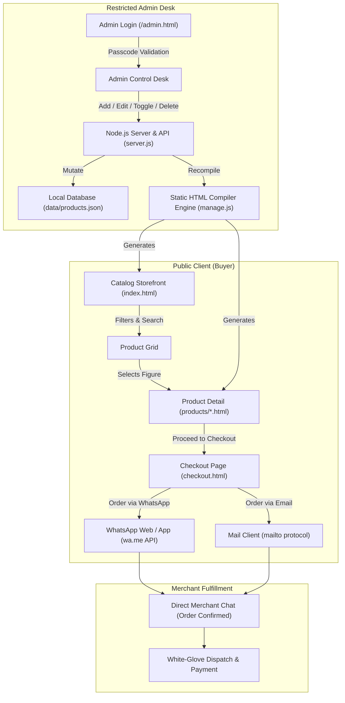

# MFU — Curated E-Commerce Catalog & Conversational Commerce Platform

<p align="center">
  
</p>

<p align="center">
  <strong>Editorial Funko Pop! Archive & Conversational Commerce Architecture</strong><br>
  <em>Zero-login buyer storefront, 1-click WhatsApp/Instagram order routing, and a lightweight single-admin management desk.</em>
</p>

<p align="center">
  <a href="https://nodejs.org/"></a>
  <a href="https://developer.mozilla.org/en-US/docs/Web/HTML"></a>
  <a href="https://developer.mozilla.org/en-US/docs/Web/CSS"></a>
  <a href="https://www.whatsapp.com/"></a>
  <a href="#license"></a>
  <a href="#contributing"></a>
</p>

---

## Table of Contents
1. [Project Overview & Conversational Commerce Architecture](#1-project-overview--conversational-commerce-architecture)
2. [Data Flow & System Architecture](#2-data-flow--system-architecture)
3. [Key Features](#3-key-features)
   - [Buyer Experience](#buyer-experience)
   - [Admin Experience](#admin-experience)
4. [Project Structure](#4-project-structure)
5. [Getting Started & Local Development](#5-getting-started--local-development)
6. [Environment Variables Reference](#6-environment-variables-reference)
7. [WhatsApp Link Configuration Guide](#7-whatsapp-link-configuration-guide)
8. [Deployment & Custom Domain Setup](#8-deployment--custom-domain-setup)
   - [Option A: Full Node.js Deployment (Render, Railway, VPS, Docker)](#option-a-full-nodejs-deployment-render-railway-vps-docker)
   - [Option B: Static Edge Deployment (Cloudflare Pages, Vercel, GitHub Pages)](#option-b-static-edge-deployment-cloudflare-pages-vercel-github-pages)
   - [DNS & Custom Domain Setup](#dns--custom-domain-setup)
9. [Security & Best Practices](#9-security--best-practices)
10. [License & Contributing](#10-license--contributing)

---

## 1. Project Overview & Conversational Commerce Architecture

**MFU** is a high-performance, lightweight catalog e-commerce platform designed for boutique collector archives, specialty retailers, and direct-to-consumer (D2C) brands.

### The Problem with Traditional E-Commerce
* High cart abandonment rates caused by forced account registrations and multi-step checkouts.
* Heavy runtime bloat, sluggish initial page loads, and recurring SaaS subscription fees.
* High customer support overhead when coordinating custom shipping, authentication verification, or pre-orders.

### The Solution: Zero-Login Conversational Commerce
MFU replaces heavy shopping carts with a **high-conversion conversational funnel**:
1. **Frictionless Discovery:** Buyers browse a curated static catalog with Didot typography, interactive 3D card tilt physics, and instant client-side filtering.
2. **Dual-Pricing Clarity:** Every item features clear Offer Pricing, original MRP strikethroughs, and auto-calculated percentage savings badges.
3. **1-Click Direct Order:** When a buyer selects **"Proceed to Checkout"** or **"Pre-Order Now"**, the platform constructs a pre-filled, cryptographically clean order dispatch string sent directly to the merchant's **WhatsApp Concierge** (`wa.me`) or **Instagram DM**.
4. **Zero-Database Core:** The platform operates on flat-file JSON and compiled static HTML. It delivers near-instant Time to First Byte (TTFB), zero database operational costs, and near-zero server maintenance.

---

## 2. Data Flow & System Architecture



---

## 3. Key Features

### Buyer Experience
* **Zero Buyer Friction:** No accounts, passwords, SMS OTPs, or third-party payment gateways required.
* **Instant Static Speed:** Static HTML pre-compiled on the server delivers sub-100ms load times with zero client framework hydration lag.
* **Interactive Image Gallery:** Multi-angle thumbnail strip with hover lens zoom and coordinate-based mouse tracking for high-end collector inspection.
* **Smart Catalog Navigation:**
  * **Dynamic Pagination:** Automatically distributes figures into 6 products per page; hides when inventory is small and generates numbered controls as the archive expands.
  * **Status Badges:** Visual indicators for `AVAILABLE`, `PRE-ORDER` (with pulsing amber glow), and `OUT OF STOCK`.
  * **Live Search & Pills:** Instant multi-category filtering (`Anime`, `Marvel & DC`, `Gaming`, plus custom categories) and instant query matching.
* **Conversational Order Generator:** Pre-formats product reference codes, SKU titles, offer prices, and optional delivery notes into standard URI-encoded WhatsApp and Email links.

### Admin Experience
* **Secure Single-Admin Dashboard (`/admin`):**
  * Protected by master passcode authentication (`x-admin-passcode` headers).
  * Completely omitted from public navigation menus and robots indexing (`noindex, nofollow`).
* **Complete Product Lifecycle Management (CRUD):**
  * **Add Products:** Form supporting title, Offer Price (₹), Original MRP (₹), summary, specifications, and status.
  * **Multi-Image Architecture:** Dedicated upload for the **Front Cover Image** (displayed on the catalog grid) and **Multiple Angle Images** (displayed on the interactive product page).
  * **Dynamic Custom Categories:** Select from preset fandoms or click `+ Custom / New Category...` to create new categories that instantly become filter pills on the live storefront.
  * **Inline Status Toggling:** 1-click cycle between `Available`, `Pre-Order`, and `Out of Stock`.
  * **Product Deletion:** Modal confirmation that purges the record from `products.json` and unlinks its compiled static HTML file.
* **Dual Management Interfaces:** Manage inventory through the graphical web dashboard (`/admin`) or directly in the terminal via the interactive Node CLI (`node manage.js`).

---

## 4. Project Structure

```text
├── admin.html                    # Private administrative control panel & passcode gate
├── checkout.html                 # Dynamic conversational order routing page
├── index.html                    # Compiled master storefront and catalog
├── manage.js                     # Terminal CLI management application & static HTML compiler
├── server.js                     # Local HTTP static server & authenticated admin REST API
├── package.json                  # Node.js project manifest and run scripts
├── README.md                     # Technical architecture and documentation
├── .env.example                  # Environment configuration template
│
├── assets/
│   ├── css/
│   │   └── style.css             # Cloud Dancer design system & Didot typographic scale
│   ├── js/
│   │   ├── main.js               # Client engine (search, filter, pagination, checkout state)
│   │   └── gallery.js            # Image zoom, pan physics, and accordion toggles
│   └── images/                   # Optimized product photography (.webp, .svg, .png)
│
├── data/
│   ├── products.json             # Flat-file database storing catalog records and pricing
│   └── settings.json             # Atelier brand settings, contact channels, and passcode
│
├── products/                     # Compiled standalone product detail pages (e.g. spiderman.html)
│
└── templates/
    ├── index-template.html       # Master layout template for catalog homepage
    └── product-template.html     # Master editorial layout template for individual products
```

---

## 5. Getting Started & Local Development

### Prerequisites
* **Node.js:** v18.0.0 or higher
* **NPM / PNPM / Yarn:** Any standard package manager
* **Git:** Version control

### 1. Clone the Repository
```bash
git clone https://github.com/your-username/mfu-ecommerce.git
cd mfu-ecommerce
```

### 2. Configure Environment Variables
Copy the sample environment file and modify your secrets:
```bash
cp .env.example .env
```

### 2.1 Git Setup & Ignored Files
Ensure sensitive credentials and large build caches are not tracked:
```gitignore
node_modules/
.env
.DS_Store
*.log
```

> **Note on Flat-File Commits:** Because `data/products.json` and compiled pages inside `products/` constitute the public catalog, keep them tracked in Git so changes deploy automatically on push.

### 3. Launch the Local Dev Server
Start the unified static server and Admin API:
```bash
node server.js
```
The server will bind to `0.0.0.0:8080` and log local and local network IP addresses:
```text
=============================================================
  MFU — HOSTED DIRECTLY FROM YOUR PC WITH ADMIN CONTROL DESK
=============================================================
  > Public Storefront:     http://localhost:8080
  > Admin Control Panel:   http://localhost:8080/admin
  > Default Passcode:      mfu2026
  > On your Wi-Fi / Phone: http://192.168.1.x:8080
=============================================================
```

### 4. Optional: Terminal CMS Execution
If you prefer managing products directly in the terminal without a browser:
```bash
node manage.js
```

---

## 6. Environment Variables Reference

Configure these settings in your `.env` file or hosting dashboard:

| Variable | Type | Default | Description |
| :--- | :---: | :---: | :--- |
| `PORT` | `Number` | `8080` | Port for the HTTP and API server. |
| `NODE_ENV` | `String` | `development` | Runtime environment (`development` / `production`). |
| `ADMIN_PASSCODE` | `String` | `mfu2026` | Master secret key required to access `/admin` and write to API. |
| `STORE_NAME` | `String` | `MFU` | Brand name rendered in page titles and navigation. |
| `WHATSAPP_PHONE_RAW` | `String` | `916366196633` | International format phone without `+` or spaces for `wa.me` links. |
| `CONTACT_EMAIL` | `String` | `mfucollectibles@gmail.com` | Primary recipient for email orders. |
| `INSTAGRAM_HANDLE` | `String` | `@mfu.pop` | Brand Instagram account handle. |
| `CURRENCY_SYMBOL` | `String` | `₹` | Currency symbol rendered across cards and product pages. |
| `PRODUCTS_PER_PAGE` | `Number` | `6` | Number of cards rendered per catalog pagination page. |

---

## 7. WhatsApp Link Configuration Guide

MFU utilizes the official WhatsApp Click-to-Chat API schema (`wa.me`) to bridge buyers directly to your merchant chat without requiring third-party plugins.

### URL Construction Specification
```text
https://wa.me/<WHATSAPP_PHONE_RAW>?text=<ENCODED_MESSAGE>
```

### Logic Implementation (`assets/js/main.js`)
When a buyer accesses `checkout.html?product=Spider-Man&price=₹2,799&slug=pop-spiderman`, the client engine builds the dynamic string:

```javascript
const cleanPhone = "916366196633"; // Country code + Mobile number
const actionVerb = isPreOrder ? "pre-order" : "order";

let rawMessage = `Hello, I would like to ${actionVerb}: ${productName} (${productPrice}).`;
if (productSlug) rawMessage += ` [Ref: ${productSlug}]`;
if (clientName) rawMessage += `\nName: ${clientName}`;
if (clientAddress) rawMessage += `\nShipping Address: ${clientAddress}`;
if (clientNote) rawMessage += `\nSpecial Request: ${clientNote}`;

const whatsappUrl = `https://wa.me/${cleanPhone}?text=${encodeURIComponent(rawMessage)}`;
document.getElementById('btnOrderWhatsApp').href = whatsappUrl;
```

### Resulting Output in WhatsApp
```text
Hello, I would like to order: Pop! Marvel: Spider-Man (Brand New Day / No Way Home Final Suit) (₹2,799). [Ref: spiderman-no-way-home-final-suit]
Name: Vikram Sharma
Shipping Address: Indiranagar, Bangalore 560038
Special Request: Mint box inspection requested, gift wrapping with collector card
```

---

## 8. Deployment & Custom Domain Setup

### Option A: Full Node.js Deployment (Render, Railway, VPS, Docker)
Because MFU contains an integrated Node.js API (`server.js`) for the Admin Panel, deploying to a Node environment allows the Admin Panel to create, edit, and delete products live.

#### Deploying with Docker
Create a `Dockerfile` in the root:
```dockerfile
FROM node:18-alpine
WORKDIR /app
COPY package*.json ./
RUN npm install --production
COPY . .
EXPOSE 8080
CMD ["node", "server.js"]
```
Build and run:
```bash
docker build -t mfu-store .
docker run -d -p 8080:8080 --name mfu-app mfu-store
```

#### Deploying on Render / Railway
1. Connect your GitHub repository.
2. Select **Web Service**.
3. **Build Command:** `npm install` (or leave empty)
4. **Start Command:** `node server.js`
5. Add environment variable: `ADMIN_PASSCODE=your_secure_password`.

---

### Option B: Static Edge Deployment (Cloudflare Pages, Vercel, GitHub Pages)
If you wish to host the buyer storefront purely as static files for maximum global speed:
1. Compile your pages locally:
   ```bash
   node -e "import('./manage.js').then(m => { m.rebuildAll(m.loadProducts(), m.loadSettings()); })"
   ```
2. Deploy the root directory containing `index.html`, `checkout.html`, `products/`, and `assets/`.
3. *(Note: On static-only hosts, the `/admin` API routes require a backend adapter or Cloudflare Worker).*

> **Architecture Recommendation:** 
> * If you want the web-based `/admin` dashboard to work online without a terminal, use **Option A (Render / Railway / VPS)** because it runs `server.js` persistently.
> * If you deploy to **Option B (Cloudflare Pages / Vercel)**, manage your inventory locally using `node manage.js`, run the build command, and push the generated HTML files to GitHub.

---

### DNS & Custom Domain Setup

To connect a purchased domain (e.g., `www.mfucollectibles.com`):

1. **Access your Domain Registrar** (e.g., Namecheap, GoDaddy, Google Domains, Cloudflare DNS).
2. **Add DNS Records**:

| Type | Name / Host | Value / Target | TTL |
| :---: | :---: | :---: | :---: |
| **A Record** | `@` (root) | `YOUR_SERVER_IP` (e.g., `76.76.21.21`) | Automatic / 300s |
| **CNAME** | `www` | `your-app-domain.com` (or `@`) | Automatic / 300s |

3. **SSL / HTTPS Provisioning:**
   * If using Cloudflare DNS: Enable the orange cloud proxy to receive automated free SSL/TLS certificates and global DDoS mitigation.
   * If using a standalone VPS (Nginx): Use Certbot:
     ```bash
     sudo certbot --nginx -d mfucollectibles.com -d www.mfucollectibles.com
     ```

---

## 9. Security & Best Practices

1. **Protected Admin Routes (`/api/*`):**
   * All mutating requests (`/api/products/create`, `/api/products/update`, `/api/products/delete`, `/api/products/toggle`) enforce strict authentication checks against `ADMIN_PASSCODE`.
   * Requests without a valid `x-admin-passcode` header or `Bearer` token return immediate `401 Unauthorized` responses.
2. **Payload Limiting:**
   * `server.js` enforces a 30 MB maximum request body ceiling to prevent heap allocation attacks during multi-image base64 uploads.
3. **Directory Traversal Mitigation:**
   * Static path resolution utilizes `path.normalize()` and explicitly strips relative directory climbs (`../`), preventing unauthorized access to system files outside the workspace root.
4. **CORS & Zero-Tracking:**
   * Zero third-party analytics trackers, zero external database credentials exposed to the frontend, and zero user cookies stored without necessity.

---

### Direct Commit Checklist
You can save this directly in your project's root folder and push your changes to GitHub:

```bash
# From your project root
git add README.md .gitignore .env.example
git commit -m "docs: add comprehensive architectural README and git configuration"
git push origin main
```

---

## 10. License & Contributing

### Contributing
Contributions, suggestions, and feature proposals are welcome!
1. Fork the Project.
2. Create your Feature Branch (`git checkout -b feature/NewFandomSupport`).
3. Commit your Changes (`git commit -m 'feat: Add Marvel Chase category'`).
4. Push to the Branch (`git push origin feature/NewFandomSupport`).
5. Open a Pull Request.

### License
Distributed under the **MIT License**. See `LICENSE` for more information.

---

<p align="center">
  <strong>© 2026 MFU. All Rights Reserved.</strong><br>
  Curated Funko Pop! Archive • Built with Didot Typographic Scale & Cloud Dancer Aesthetic.
</p>
